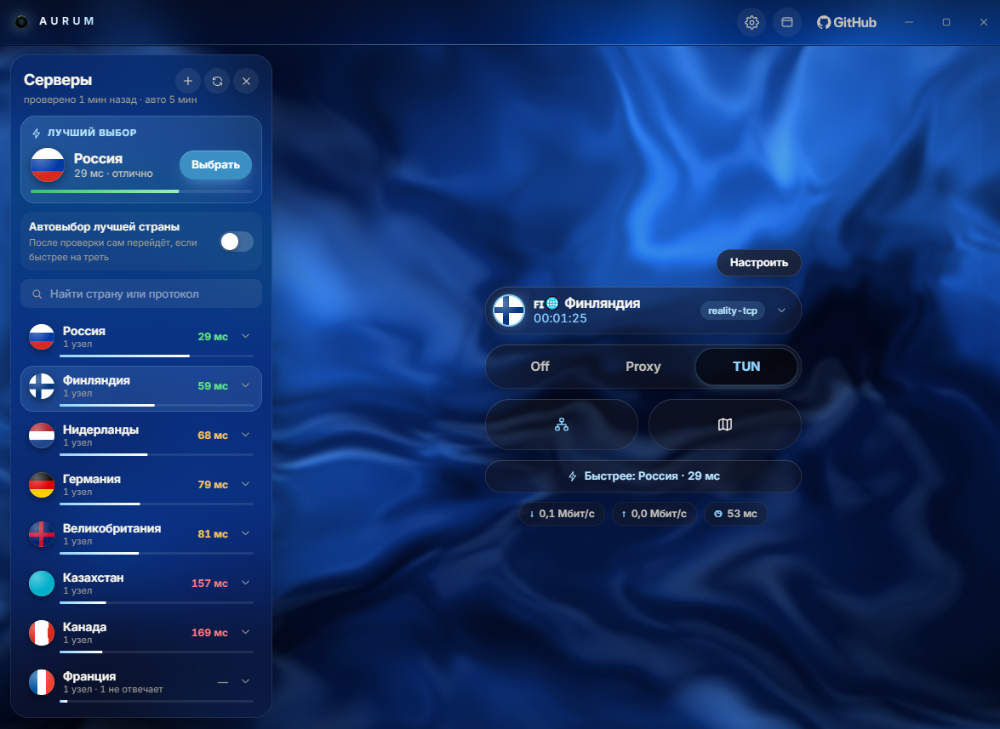
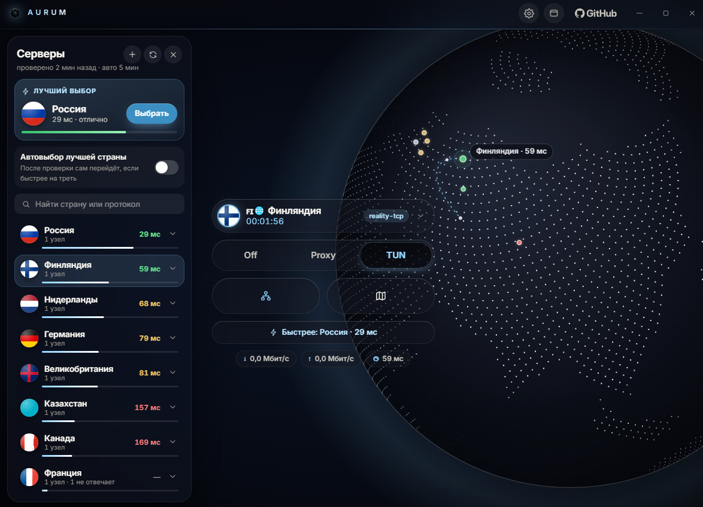
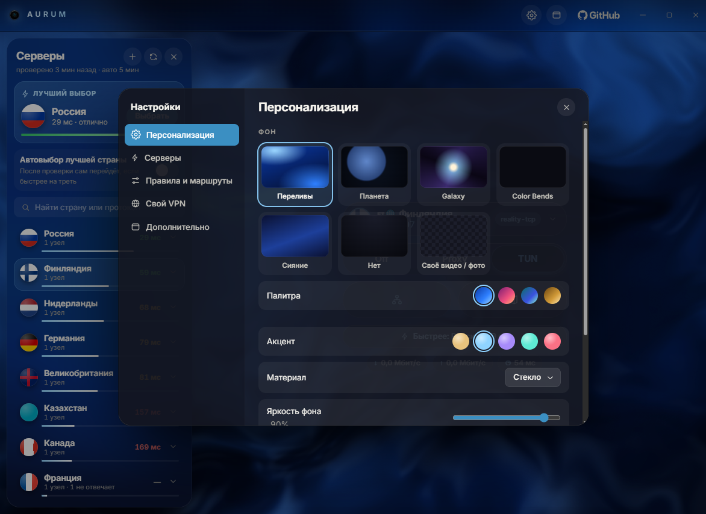

<div align="center">

# AURUM

### Твой VPN. Красиво, как должно быть.

Стеклянный клиент для Windows на ядре [Affory](https://github.com/zxczxczxczxczxczxc1111/affory).<br>
Один взгляд на экран, и всё понятно. Одно касание, и ты в сети.

[**Скачать для Windows**](https://github.com/karl-junhky/aurum/releases/latest)

<br>



</div>

<br>

## Всё главное в одной пилюле

Сервер, время в сети и три режима: **Off**, **Proxy** и **TUN**. Ползунок переключается пружиной, флаги круглые, стекло матовое. Всё остальное прячется, пока не понадобится.

**Proxy** отправляет через VPN только то, что решают правила. **TUN** отправляет весь трафик. Полное окно Affory возвращается одной кнопкой.

<br>

## Лучший сервер выбирает сам

AURUM собирает серверы по странам и оценивает каждую. Он смотрит на пинг, на то, насколько он скачет, и на узлы, которые не отвечают. Лучшая страна показывается сверху, в карточке «Лучший выбор». Остальные идут ниже с цветными полосками от зелёного до красного.

Проверка идёт сама: раз в 2, 5, 10 или 30 минут, как скажешь. Включи **автовыбор**, и AURUM переключится на другую страну, когда она быстрее минимум на треть и на 20 мс. Если выигрыш мельче, ничего не дёргается.

<br>

## Планета, которую можно взять в руки

Крути её мышью, она докручивается по инерции. Колёсико приближает, двойной щелчок возвращает как было. На поверхности страны с пингом в цвете и дуга от тебя до выбранного сервера. Нажми на метку, и страна выбрана.

<div align="center">



</div>

<br>

## Твой фон. Твой вкус.

Переливы на WebGL в четырёх палитрах. Планета. Galaxy. Color Bends. Сияние. Или собственное **видео** (mp4, webm) и **фото**. Файл остаётся внутри окна и никуда не уходит из твоего компьютера.

Окно «Настроить» сделано в духе macOS: акцент в пяти цветах, материал на выбор (стекло, туман, матовый), яркость фона, зерно плёнки, интервал автопроверки.

<div align="center">



</div>

<br>

## Плавно по-настоящему

Анимируются только `transform` и `opacity`. Если кадр занимает дольше 24 мс, фон сам снижает разрешение, и интерфейс остаётся живым. А при включённом «Уменьшении движения» в Windows анимации затихают.

<br>

## Под капотом всё то же

AURUM это форк Affory, в котором переписан только внешний вид. Ядро, служба, протоколы, правила, «Свой VPN» и обновления остаются как у Affory и приходят из него.

Весь новый код лежит в одной папке `cmd/affory-ui/frontend/src/skin/`. В файлах Affory изменены **две строки**: `import "./skin"` в `src/main.tsx` и `media-src` в `src/csp.ts`. Без второй политика безопасности не даст проиграть собственное видео на фоне.

AURUM не копирует логику Affory. Он читает то, что нарисовал настоящий экран (`data-testid`, `aria-label`), и нажимает те же кнопки. Поэтому всё, что апстрим улучшает в ядре, правилах и протоколах, появляется в AURUM само.

### Обновления из Affory

Workflow `.github/workflows/sync-upstream.yml` раз в 6 часов:

1. смотрит, вышло ли что-то новое в апстриме;
2. сливает это в `main`;
3. гоняет проверку типов, тесты апстрима, тест моста и сборку;
4. если всё зелёное, отправляет в `main`. Если что-то упало (обычно апстрим переименовал якорь), открывает Pull Request, а `main` остаётся рабочим.

Вручную: `git fetch upstream && git merge upstream/main`.

<br>

## Установка

Скачай `AURUM-<версия>-setup.exe` из [Releases](https://github.com/karl-junhky/aurum/releases/latest) и запусти. Рядом лежит файл `.sha256` для проверки.

Сборка в Releases пока без цифровой подписи, поэтому Windows SmartScreen может предупредить. Нажми **Подробнее**, затем **Выполнить в любом случае**.

Служба, процессы, пути в профиле и журналы по-прежнему называются Affory. Так ядро и обновления остаются совместимыми с апстримом.

<br>

## Сборка из исходников

Как в Affory: см. [README апстрима](../README.md) и папку `ustanovka/`. Фронтенд:

```sh
cd cmd/affory-ui/frontend
npm ci
npm run build
```

Предпросмотр без Windows и без службы, на заглушке апстрима:

```sh
npx vite --config vite.stend.config.ts   # http://127.0.0.1:9245/?ekran=podklyuchenie
```

Установщик собирается на GitHub: **Actions** → «Сборка Windows (пробная)» → **Run workflow**. Готовый файл появляется в Releases.

<br>

## Лицензия и авторы

GPL-3.0, как у Affory (см. `LICENSE`). Оригинальный проект и его авторы: [zxczxczxczxczxczxc1111/affory](https://github.com/zxczxczxczxczxczxc1111/affory).
