<p align="center">
  
</p>

<h1 align="center">Affory</h1>

<p align="center">VPN-клиент для Windows: сам ставит VPN на твой сервер и пускает через него весь трафик или только выбранные приложения и сайты</p>

<p align="center">
  <a href="https://github.com/zxczxczxczxczxczxc1111/affory/releases/latest"></a>
  <br>
  <sub>Windows 10 и 11 · x64 · русский интерфейс</sub>
</p>

<p align="center">
  <a href="assets/screenshots/connection.jpg">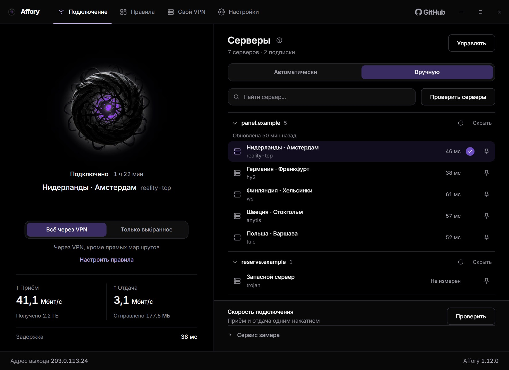</a>
  <br>
  <sub>Главный экран: сфера включает и выключает VPN, справа серверы по подпискам</sub>
  <br>
  <sub>Данные на снимках демонстрационные</sub>
</p>

## Свой VPN

Арендуй сервер, вставь письмо хостера в Affory и через пару минут получи свой VPN на компьютере и телефоне. Терминал и веб-панель не нужны: Affory сам входит на сервер, ставит программу, выпускает сертификат и проверяет каждый ключ.

<table>
  <tr>
    <td width="50%"><a href="assets/screenshots/svoy-vpn-pismo.jpg">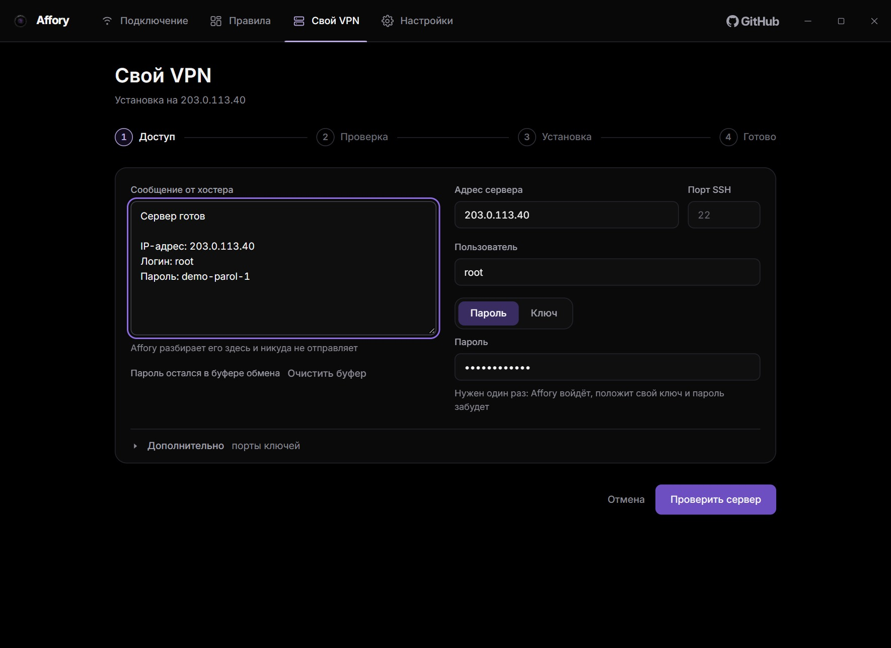</a></td>
    <td width="50%"><a href="assets/screenshots/svoy-vpn-porty.jpg">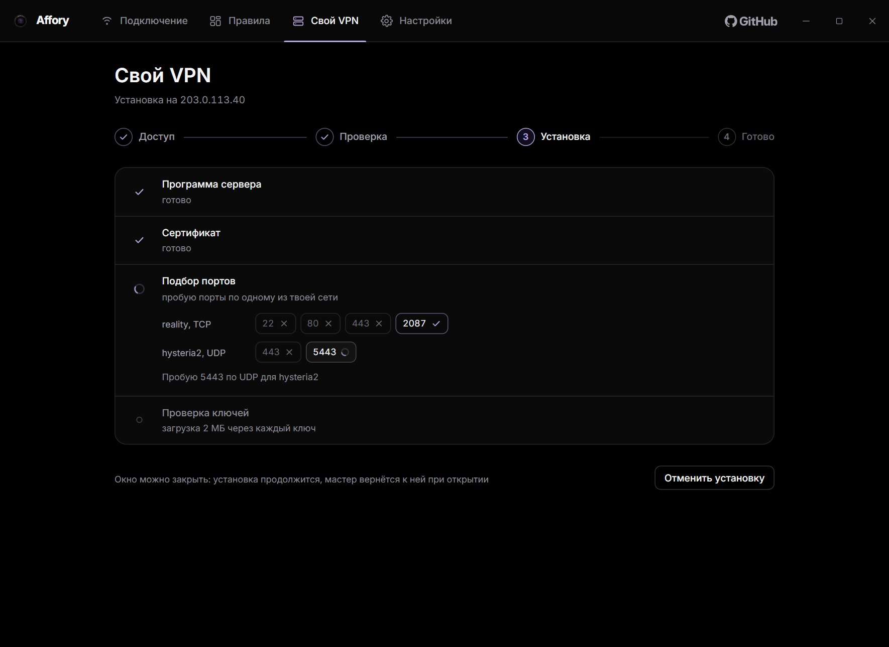</a></td>
  </tr>
  <tr>
    <td align="center"><b>Письмо хостера</b><br><sub>Адрес, логин и пароль Affory достаёт сам</sub></td>
    <td align="center"><b>Подбор портов</b><br><sub>Остаётся порт, через который идут данные из твоей сети</sub></td>
  </tr>
  <tr>
    <td width="50%"><a href="assets/screenshots/svoy-vpn-gotovo.jpg">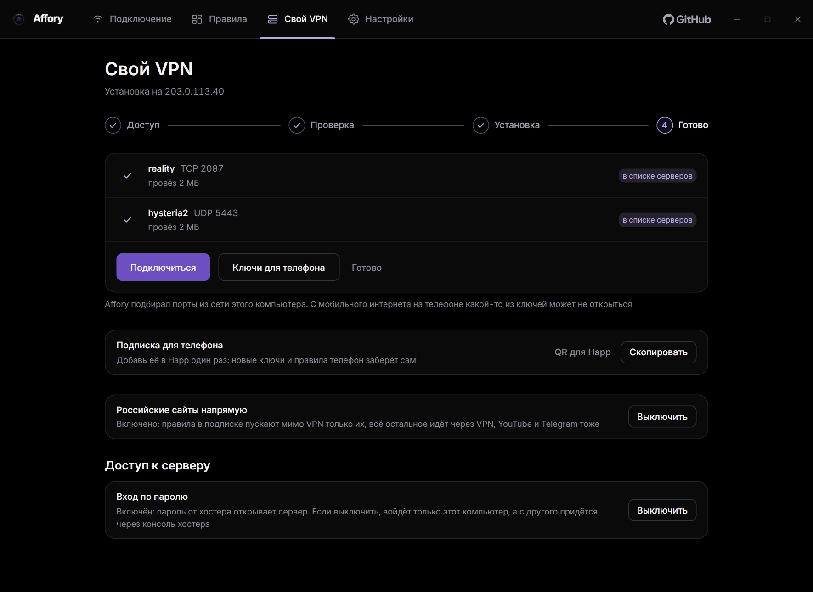</a></td>
    <td width="50%"><a href="assets/screenshots/svoy-vpn-server.jpg">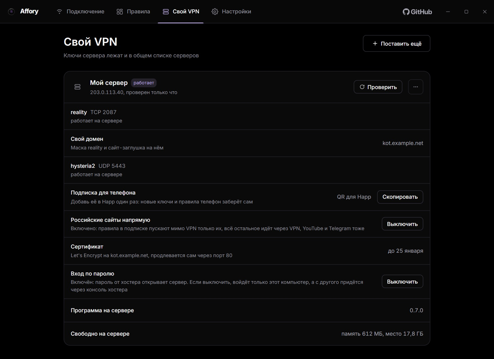</a></td>
  </tr>
  <tr>
    <td align="center"><b>Готово</b><br><sub>Каждый ключ проверен загрузкой 2 МБ</sub></td>
    <td align="center"><b>Карточка сервера</b><br><sub>Состояние, ключи, подписка и обслуживание</sub></td>
  </tr>
</table>

1. **Арендуй сервер.** Подойдёт VPS на KVM со своим адресом IPv4, Ubuntu 20.04 или новее и памятью от 1 ГБ. Сервер нужен пустой: Affory занимает его целиком.
2. **Вставь письмо хостера.** Раздел «Свой VPN» → <kbd>Поставить на свой сервер</kbd>. Адрес, логин и пароль Affory найдёт в письме сам, вместо пароля можно выбрать файл ключа SSH. Пароль нужен один раз: Affory положит на сервер свой ключ и пароль забудет.
3. **Выбери, как выдавать ключи.** «Просто ключи» дают два ключа ссылками и QR-кодами. «Свой домен» ставит на домен сайт-заглушку и даёт телефону одну подписку. Нажми <kbd>Поставить VPN</kbd>.

Ключи reality и hysteria2 сразу появляются в списке серверов, для телефона есть QR-код.

### Что Affory делает за тебя

Дальше Affory работает сам:

- **Порты из твоей сети**: Affory пробует порты по одному и оставляет тот, через который идут данные. После установки каждый ключ провозит 2 МБ
- **Причина, если ключ не проходит**: сеть пускает только разрешённые сайты, адрес закрыт, порт закрыт у хостера, соединение глушат по дороге или порт перехватывает Avast
- **Малоизвестная маска reality**: Affory ищет её среди соседей твоего сервера, и у каждого сервера она своя. Известные имена вроде www.adobe.com на мобильном интернете глушат. Маску можно сменить одной кнопкой или ввести свою, а сервер раз в час проверяет, что сайт-маска отвечает
- **Свой домен по желанию**: на домене встаёт сайт-заглушка, reality прячется за ним, а Happ на телефоне забирает новые ключи и правила из подписки. Домен можно подключить и потом, из карточки сервера
- **Российские сайты напрямую и на телефоне**: правила для Happ пускают мимо VPN только российские сайты, остальное идёт через VPN. YouTube, Telegram и другие заблокированные сервисы идут через VPN, даже когда отвечают с российских адресов
- **Сертификат**: сервер сам выпускает и продлевает сертификат Let's Encrypt, Affory предупредит, если продление встало
- **Обслуживание из карточки сервера**: проверка, обновление программы сервера с возвратом прежней при неудаче, смена портов и маски, своё название, выключение входа по паролю и снос

### Сравнение с похожими программами

| | Affory | AmneziaVPN | Outline | 3x-ui | Hiddify Manager |
|---|---|---|---|---|---|
| Как ставится сервер | из окна, по письму хостера | из окна, по SSH | сам создаёт сервер только на DigitalOcean и Google Cloud, на остальных команда в терминале | скрипт в терминале, дальше веб-панель | команда в терминале, дальше веб-панель |
| Протоколы | reality и hysteria2 | AmneziaWG, WireGuard, OpenVPN, XRay с reality и другие, hysteria2 нет | только Shadowsocks | VLESS с reality, hysteria2, TUIC, WireGuard и другие | больше 20, среди них reality и hysteria2 |
| Маска reality | малоизвестный сайт из соседей твоего сервера | www.googletagmanager.com, меняется руками | reality нет | вводишь сам, сканер проверяет известные сайты или адреса, которые ты укажешь | случайная из встроенного списка известных сайтов |
| Порты пробуются из твоей сети | да | нет, проверяется только, что порт свободен на сервере | нет | нет | нет |
| Каждый ключ проверяется передачей данных | да, с твоего компьютера | нет | нет | нет | вручную, с сервера панели |
| Свой домен, сайт-заглушка, подписка и Let's Encrypt | да, из окна | нет | нет | подписка есть, сертификат из меню в терминале, заглушки нет | да |
| Российские сайты напрямую в подписке для Happ | да | нет | нет | правила для Happ есть, российского набора нет | режим для своих клиентов и Clash, для Happ нет |
| Выключить вход по паролю | да | нет | нет | нет | нет, только предупреждение |
| Снести с сервера | из окна | из окна | только облачный сервер | в терминале | в терминале |

<sub>По коду и документации на 06.11.2026: AmneziaVPN 5.1.0.6, Outline server-v1.12.3, 3x-ui v3.11.0, Hiddify Manager v14.0.5. «Нет» значит, что в коде и документации этого не нашлось</sub>

Чего в Affory нет: WireGuard, AmneziaWG и OpenVPN, версий для macOS и Linux и панели на много пользователей, как у 3x-ui, Marzban и Remnawave. На телефоне ключи открывает Happ или другой клиент с reality и hysteria2.

## Установка

Понадобится свой сервер (см. «Свой VPN»), ключ VPN-сервера или подписка от провайдера.

1. **Установи.** Скачай `Affory-<версия>-setup.exe` со страницы [последнего выпуска](https://github.com/zxczxczxczxczxczxc1111/affory/releases/latest) и запусти. Установщик попросит права администратора, дальше программа работает без них.
2. **Добавь сервер.** Свой сервер ставится в разделе «Свой VPN». Чужой ключ или подписку добавь кнопкой <kbd>Управлять</kbd>: вставь ключ или адрес подписки, можно кнопкой <kbd>из буфера</kbd>. Кнопка <kbd>QR с экрана</kbd> прочитает QR-код, Affory покажет найденное и добавит его после подтверждения.
3. **Подключись.** Нажми на сферу, второе нажатие отключает VPN.

> Установщик подписан самоподписанным сертификатом. SmartScreen его не знает и может предупредить о неизвестном издателе. Сверить файл с выпуском можно по сумме SHA-256, см. «Проверка файлов выпуска» в справке ниже.

## Возможности

### Правила

- **Весь трафик через VPN или только выбранное**: приложения вместе с программами, которые они запускают, и сайты со всеми поддоменами
- **Готовые наборы** для YouTube, Discord, ChatGPT, Claude, Telegram, Steam и других сервисов
- **Российские сайты напрямую** одним переключателем
- **Блокировка рекламы и трекеров** списками HaGeZi для всего компьютера, с исключениями, по умолчанию выключена

### Серверы и подписки

- **Несколько подписок**, все обновляются раз в 12 часов; на сервер запасной подписки можно перейти, даже когда её панель не отвечает
- **Автоматический или ручной выбор сервера** и пинг каждого сервера одним числом, как в играх и Discord
- **Выгрузка ключей** списком по серверам: <kbd>Выгрузить</kbd> на экране «Управлять», у каждого сервера свои <kbd>Скопировать</kbd> и <kbd>QR</kbd>
- **Ключ одного сервера** в его меню правой кнопки: <kbd>Скопировать ключ</kbd> и <kbd>Показать ключ и QR</kbd>
- **Запасной DNS**: если DNS провайдера не отдаёт адрес сервера или подписки, Affory спрашивает публичный DNS Google и Cloudflare через HTTPS

### Защита и запуск

- **Блокировка сети** при обрыве VPN
- **Запуск в трее** при входе в Windows
- **Подключение до входа** в систему

### Проверки и обслуживание

- **Замер скорости**, проверка утечек и адреса выхода
- **Проверка сети по частям**: VPN, сервер, имена сайтов, голос и видео
- **Обновление одной кнопкой**, о новой версии напоминают трей и главный экран
- **Диагностика одним файлом** без ключей для сообщения об ошибке

## Экраны

<table>
  <tr>
    <td width="50%"><a href="assets/screenshots/services.jpg">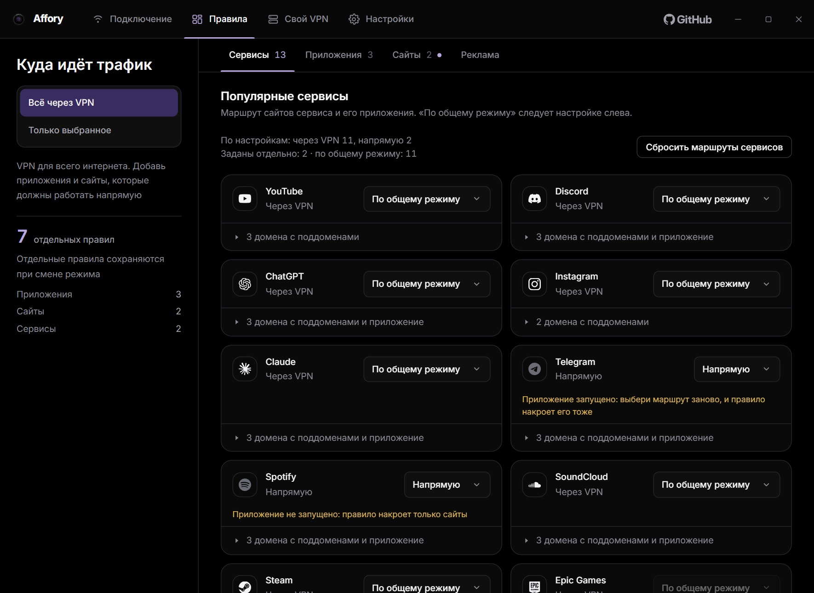</a></td>
    <td width="50%"><a href="assets/screenshots/applications.jpg">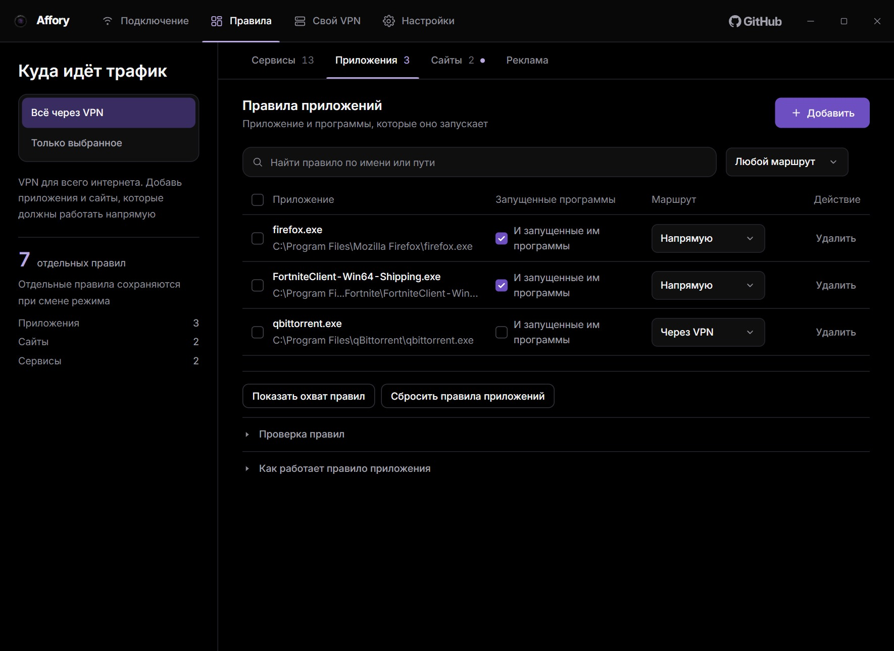</a></td>
  </tr>
  <tr>
    <td align="center"><b>Сервисы</b><br><sub>Маршрут для сайтов и приложения сервиса</sub></td>
    <td align="center"><b>Приложения</b><br><sub>Маршрут для программы и всего, что она запускает</sub></td>
  </tr>
  <tr>
    <td width="50%"><a href="assets/screenshots/sites.jpg">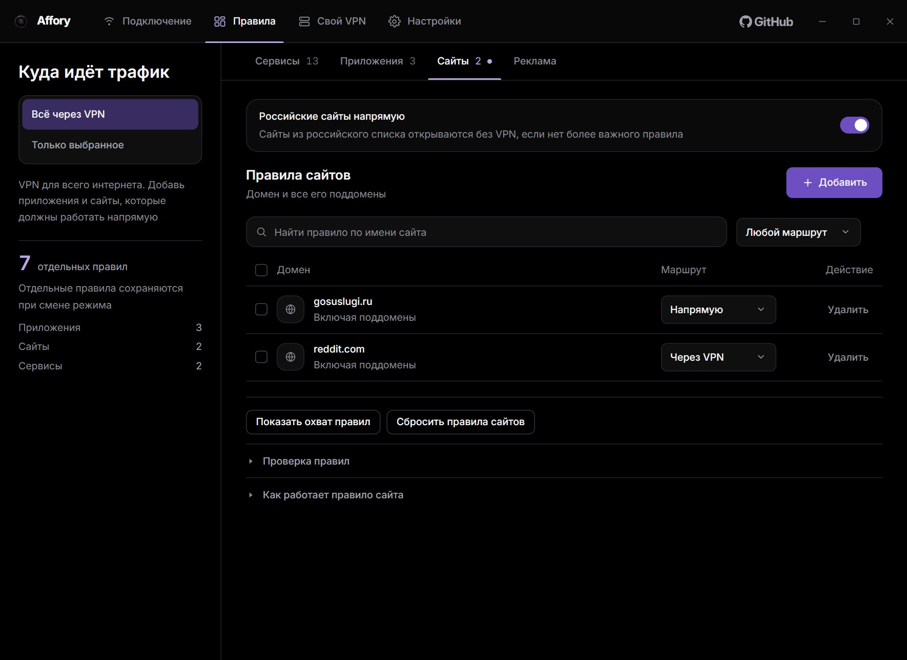</a></td>
    <td width="50%"><a href="assets/screenshots/servers.jpg">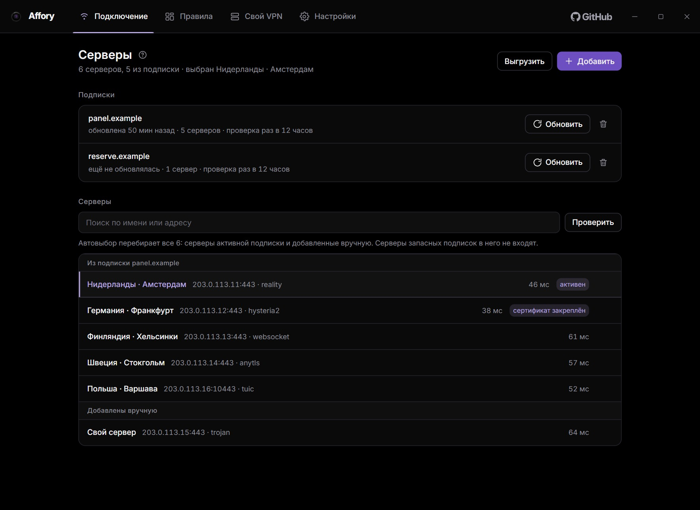</a></td>
  </tr>
  <tr>
    <td align="center"><b>Сайты</b><br><sub>Домен со всеми поддоменами, российский список отдельно</sub></td>
    <td align="center"><b>Серверы и подписки</b><br><sub>Подписки, ручные серверы и выгрузка ключей</sub></td>
  </tr>
  <tr>
    <td width="50%"><a href="assets/screenshots/protocols.jpg">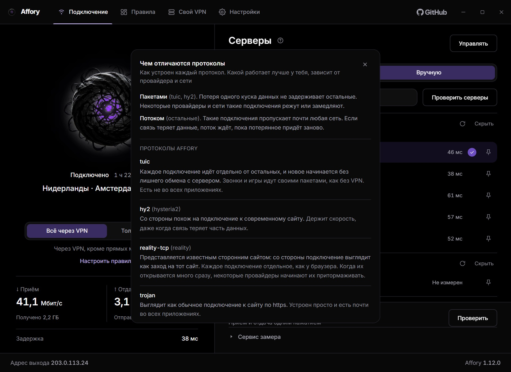</a></td>
    <td width="50%"><a href="assets/screenshots/settings.jpg">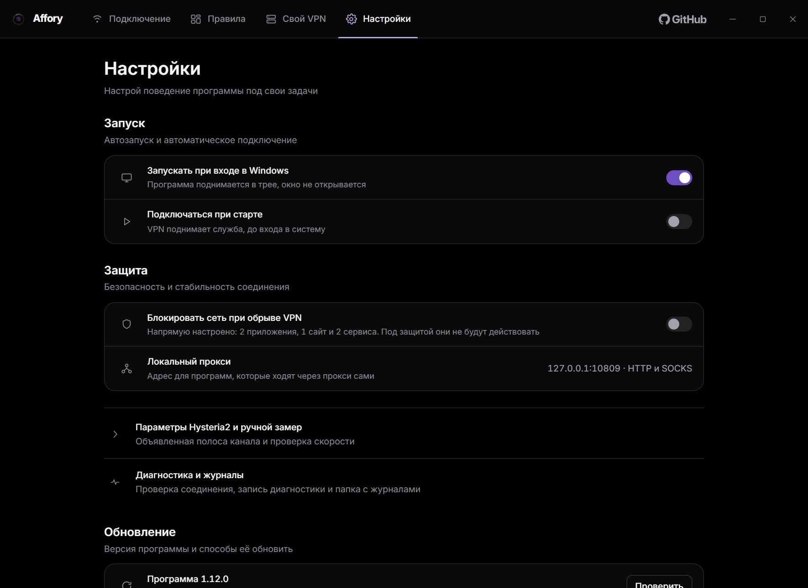</a></td>
  </tr>
  <tr>
    <td align="center"><b>Чем отличаются протоколы</b><br><sub>Справка у заголовка «Серверы»</sub></td>
    <td align="center"><b>Настройки</b><br><sub>Запуск, защита, диагностика и обновление</sub></td>
  </tr>
</table>

## Справка

<details>
<summary><b>Частые вопросы</b></summary>

**Задержка и пинг серверов.** «Задержка» под сферой это один круг до интернета через VPN, то же, что пинг в играх и Discord. Пинг в списке серверов Affory меряет так же для каждого сервера и берёт лучший из трёх кругов. <kbd>Проверить серверы</kbd> работает и без подключения.

**Правила «Напрямую» не действуют.** Проверь «Настройки» → «Защита»: при включённой «Блокировать сеть при обрыве VPN» весь трафик идёт через VPN.

**Реклама на YouTube осталась.** Блокировка смотрит на имена сайтов, а YouTube и Twitch отдают рекламу со своих же адресов. Браузер с вручную включённым защищённым DNS тоже обходит список.

**Обновление.** Affory раз в сутки проверяет последний выпуск на GitHub. Новую версию поставь кнопкой <kbd>Установить</kbd> в разделе «Настройки» → «Обновление», туда же ведут пункт трея и плашка «Есть версия …» на главном экране. Если новая версия не поднимется за 20 секунд, останется прежняя.

**Перенос на другой компьютер.** «Настройки» → «Профиль и обслуживание» → «Вывести профиль» сохраняет серверы, подписки и правила одним файлом под паролем. На новом компьютере открой тот же раздел и нажми <kbd>Ввести</kbd>. Ключи для телефона отдаёт кнопка <kbd>Выгрузить</kbd> на экране «Управлять».

**После отключения пропал интернет.** В папке программы лежит `ESLI-NET-INTERNETA.txt` с командами, которые снимают защиту Affory и возвращают сеть.

**GitHub недоступен.** Скачай `affory-<версия>.zip` и `affory-<версия>.zip.sha256`, положи в одну папку и выбери архив: «Настройки» → «Обновление» → «Архив сборки» → <kbd>Выбрать архив</kbd>. Для этого нужны права администратора.

**Удаление.** «Настройки» → «Профиль и обслуживание» → «Удалить программу» или ярлык «Удалить Affory» в меню «Пуск». По умолчанию ключи остаются для следующей установки, стереть их можно в том же диалоге.

</details>

<details>
<summary><b>Свой сервер</b></summary>

**Какой сервер подойдёт.** VPS на KVM со своим адресом IPv4, Ubuntu 20.04 или новее, от 1 ГБ памяти. Не подойдут NAT (один адрес на много серверов), сервер только с IPv6, OpenVZ и LXC. Перед установкой Affory осматривает сервер и говорит, если он не подходит или на нём уже что-то стоит.

**Что ставится на сервер.** Программа сервера `vpn-uzel` (sing-box как библиотека) службой systemd, свои правила брандмауэра и сертификат Let's Encrypt. Ключей два: VLESS Reality по TCP и Hysteria2 по UDP.

**Свой домен.** Заведи у регистратора A-запись на адрес сервера без прокси Cloudflare (облачко серое), и Affory проверит её перед установкой. На домене встанет сайт-заглушка, у каждого сервера свой вид. Вернуться к простым ключам можно из карточки сервера.

**Телефон.** Ключи открываются в любом клиенте с VLESS Reality и Hysteria2: <kbd>Ключи для телефона</kbd> в карточке показывает QR-коды. Правила «Российские сайты напрямую» и подписка своего домена рассчитаны на Happ.

**Другой компьютер.** Управлять сервером может компьютер, который ставил VPN: ключ управления хранится на нём. На другом компьютере пройди мастер с тем же сервером, Affory узнает свою установку и предложит <kbd>Взять под управление</kbd>.

**Вход по паролю.** Пароль хостера после установки больше не нужен. Его можно выключить в карточке сервера, тогда на сервер войдёт только этот компьютер, а с другого придётся через консоль хостера.

**Снос.** Меню карточки → «Снести с сервера» убирает программу, свои правила брандмауэра и настройки, последним свой ключ входа. Система сервера остаётся, ключи на телефонах перестают работать.

</details>

<details>
<summary><b>Как работают правила</b></summary>

Режим выбирается на главном экране и в «Правилах»:

- **«Всё через VPN»**: трафик идёт через VPN, кроме правил с маршрутом «Напрямую»
- **«Только выбранное»**: интернет напрямую, через VPN идёт только то, что есть в правилах

У каждого правила свой маршрут, «Через VPN» или «Напрямую». Вкладки «Правил»:

- **«Сервисы»**: сайты сервиса и его приложение одним выбором; «По общему режиму» следует режиму слева
- **«Приложения»**: программа из запущенных или выбранная на диске; с флажком «И запущенные им программы» правило действует и на дочерние процессы, если Affory заметил их запуск
- **«Сайты»**: домен со всеми поддоменами и переключатель «Российские сайты напрямую»
- **«Реклама»**: блокировка рекламы и трекеров, базовый или расширенный список и исключения «Не блокировать»

Первым действует правило приложения, затем сайта, затем сервиса, а более точный домен важнее общего. Правки копятся в черновике до нажатия <kbd>Применить изменения</kbd>. При подключённом VPN это одно короткое переподключение. Пока включена «Блокировать сеть при обрыве VPN», весь трафик идёт через VPN, а правила «Напрямую» ждут её выключения.

Программам, которые умеют ходить через прокси, Affory даёт локальный прокси HTTP и SOCKS на `127.0.0.1`. Он поднимается вместе с VPN, адрес указан в разделе «Настройки» → «Защита».

</details>

<details>
<summary><b>Протоколы и ссылки</b></summary>

- **VLESS** (`vless://`): Reality поверх TCP или gRPC, TLS поверх TCP с Vision и без, WebSocket, gRPC и HTTPUpgrade с TLS или без
- **Hysteria2** (`hy2://`, `hysteria2://`), **TUIC** (`tuic://`), **AnyTLS** (`anytls://`)
- **Trojan** (`trojan://`) и **VMess** (`vmess://`) поверх TCP или WebSocket
- **Shadowsocks** (`ss://`): SIP002 и прежняя форма ссылки

Чем протоколы отличаются друг от друга, объясняет справка: кнопка <kbd>?</kbd> у заголовка «Серверы». Для Hysteria2 в «Настройках» можно объявить полосу своего канала, это включает режим Brutal. Полосу лучше измерить там же: завышенная ухудшает соединение.

Ключи вставляй по одному на строку или одним блоком base64. Подписка это адрес, по которому панель отдаёт такой же список. Affory обновляет её раз в 12 часов и по кнопке <kbd>Обновить</kbd>, а строки, которые не разобрал, показывает с номером и причиной.

Панели подписки Affory сообщает свою версию, версию и модель Windows и хеш номера машины, свой для каждого адреса подписки. Номер нужен панелям с лимитом устройств.

</details>

<details>
<summary><b>Где лежат данные и журналы</b></summary>

| Что | Где |
|---|---|
| Программа | `C:\Program Files\Affory`<br>или папка, выбранная при установке |
| Ключи, подписки, правила | `C:\ProgramData\Affory`<br>ключи зашифрованы средствами Windows (DPAPI), папку читают только система и администраторы |
| Журналы | `C:\ProgramData\Affory\log`<br>читать может любой пользователь компьютера |

В папке журналов: `sluzhba.log` служба, `yadro.log` ядро sing-box, `komandy.log` команды окна и консоли, `obnovlenie.log` и `ustanovka.log`. Ключей в них нет.

Ещё два журнала включаются в разделе «Настройки» → «Диагностика и журналы», по умолчанию оба выключены:

- **Журнал соединений** (`C:\ProgramData\Affory\soedineniya.jsonl`): приложение, адрес и маршрут каждого соединения, чтобы проверить правила
- **Подробный журнал для отладки** (`C:\ProgramData\Affory\log\diagnostika.jsonl`): порты, соединения, скорость и задержка раз в секунду, когда связь нестабильна

К сообщению об ошибке приложи файл диагностики, его сохраняет «Диагностика одним файлом» → <kbd>Сохранить</kbd> в том же разделе. В файле журналы службы без ключей и адресов подписок.

</details>

<details>
<summary><b>Проверка файлов выпуска</b></summary>

Рядом с установщиком и архивом обновления на странице выпуска лежат файлы `.sha256`. Скачай оба в одну папку и выполни там в PowerShell:

```powershell
$f = 'Affory-1.12.0-setup.exe'
(Get-FileHash $f -Algorithm SHA256).Hash -eq (Get-Content "$f.sha256").Split(' ')[0]
```

`True` значит, что файл совпадает с выпущенным. Номер версии подставь свой.

</details>

<details>
<summary><b>Консоль <code>affory-cli</code></b></summary>

`affory-cli.exe` лежит в папке программы и управляет той же службой, что и окно. Флаги ставятся после команды, идентификаторы печатают `servers list` и `subscription list`.

```text
affory-cli status
affory-cli connect [--server <id>]
affory-cli disconnect
affory-cli switch <id>                 сменить сервер на живом подключении
affory-cli mode [avto|ruchnoy]         выбор сервера; без аргумента печатает текущий
affory-cli killswitch on|off           блокировка сети при обрыве VPN
affory-cli servers list
affory-cli servers add <ссылка>
affory-cli servers remove <id>
affory-cli subscription list
affory-cli subscription add <адрес>
affory-cli subscription use <id>
affory-cli subscription remove <id>
affory-cli subscription refresh
affory-cli rules list
affory-cli autostart on|off            окно в трее при входе в Windows
affory-cli autoconnect on|off          подключение при старте службы
affory-cli journal on|off|clear        журнал соединений
affory-cli diagnostics on|off          подробный журнал для отладки
affory-cli profile export --out <файл>
affory-cli profile import --in <файл>
affory-cli events [--seconds N]        события службы
affory-cli version
```

Пароль профиля консоль спрашивает в терминале. Ссылки и адреса подписок из аргументов остаются в истории оболочки, консоль об этом предупреждает.

</details>

## Исходный код

<details>
<summary><b>Как устроен Affory</b></summary>

- **AfforySvc** (`affory-svc.exe`, Go): служба Windows. Хранит ключи, собирает конфиг ядра, поднимает туннель, ставит фильтры Windows (WFP) для блокировки сети и проверяет обновления
- **Окно** (`affory-ui.exe`): Wails 3, React и TypeScript, работает с правами обычного пользователя
- **Консоль** (`affory-cli.exe`): команды службы из терминала
- **Ядро** (`sing-box.exe`): sing-box с правилом для процесса и его потомков, трафик идёт через TUN-адаптер
- **Программа сервера** (`vpn-uzel`, Go, linux/amd64): то, что «Свой VPN» ставит на сервер. Держит ключи reality и hysteria2, сертификат, сайт-заглушку и подписку своего домена. Служба качает её со страницы выпуска и сверяет с суммой SHA-256, вшитой в сборку

Окно и консоль говорят со службой по именованному каналу. Права администратора нужны установке и обновлению из архива с диска.

Код: `cmd/affory-svc`, `cmd/affory-ui` (интерфейс в `cmd/affory-ui/frontend`), `cmd/affory-cli`, общие пакеты в `internal`, установщик и сборка ядра в `ustanovka`.

</details>

<details>
<summary><b>Сборка из исходников</b></summary>

Исходники выпуска приложены к нему архивом `Affory-<версия>-sources.zip`. Для сборки нужны Go (версию задаёт строка `toolchain` в `go.mod`) и Node.js с npm.

```powershell
cd cmd\affory-ui\frontend
npm ci
npm run build
cd ..\..\..
go build -o affory-svc.exe ./cmd/affory-svc
go build -o affory-cli.exe ./cmd/affory-cli
go build -tags production -ldflags "-H windowsgui" -o affory-ui.exe ./cmd/affory-ui
```

Ядро собирает `ustanovka/sobrat-yadro.ps1`, ему нужны git и Go. Скрипт берёт sing-box нужной версии и накладывает патчи из `ustanovka/patches`. Что они меняют и как повторить сборку, описано в [`ustanovka/YADRO-ISHODNIKI.txt`](ustanovka/YADRO-ISHODNIKI.txt).

Программу сервера для «Своего VPN» собирает `uzel/sobrat.sh` под linux/amd64, ему нужны bash 4+, git, Go и GNU coreutils. Как повторить сборку, описано в [`ustanovka/UZEL-ISHODNIKI.txt`](ustanovka/UZEL-ISHODNIKI.txt).

</details>

<details>
<summary><b>Лицензии</b></summary>

Affory распространяется под [GPL-3.0-or-later](LICENSE). Ядро это сборка [sing-box](https://github.com/SagerNet/sing-box) (GPL-3.0-or-later) с патчами из `ustanovka/patches`, программа сервера `uzel` собрана на sing-box как на библиотеке и тоже под GPL-3.0-or-later. Каталог сервисов собран из [OpenCCK](https://github.com/rekryt/iplist) (MIT), списки рекламы из [HaGeZi DNS Blocklists](https://github.com/hagezi/dns-blocklists) (GPL-3.0), шрифт [Inter](https://github.com/rsms/inter) под SIL OFL 1.1, значки сервисов из [Simple Icons](https://github.com/simple-icons/simple-icons) (CC0). Подробности в [`THIRD_PARTY_NOTICES.txt`](THIRD_PARTY_NOTICES.txt).

</details>

---

<p align="center"><sub><a href="https://github.com/zxczxczxczxczxczxc1111/affory/issues">Ошибки и предложения</a> · <a href="SECURITY.md">Сообщить об уязвимости приватно</a> · <a href="LICENSE">GPL-3.0-or-later</a></sub></p>
